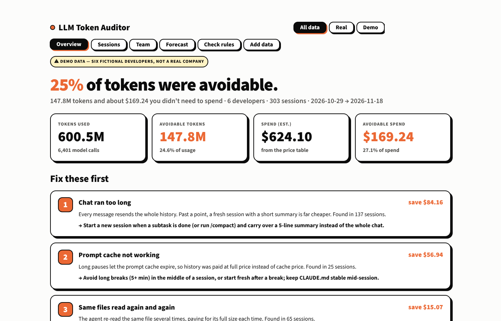
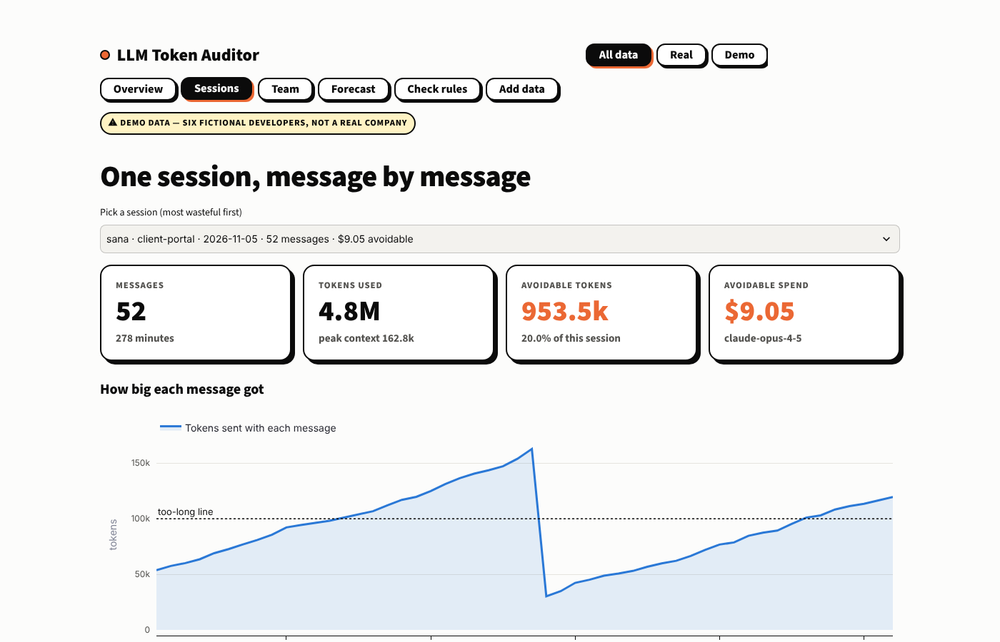
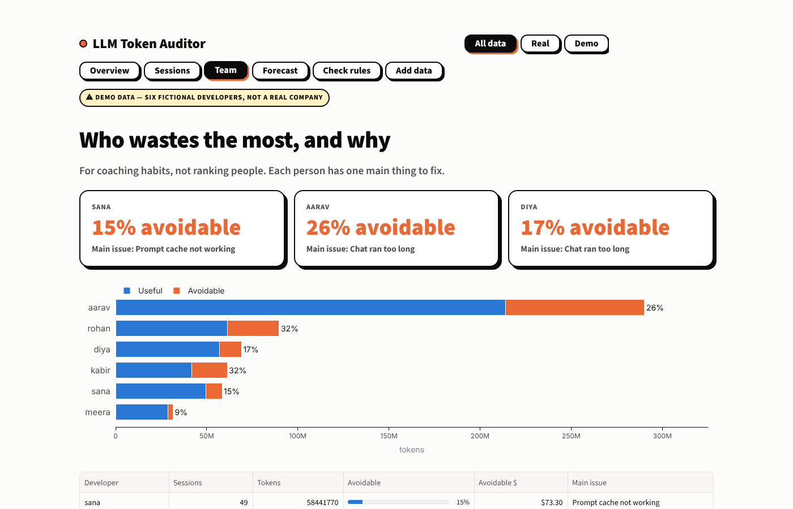
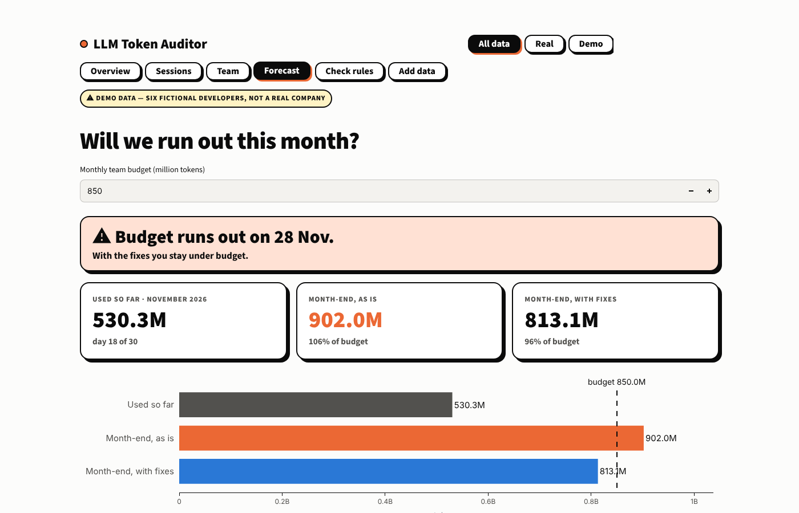
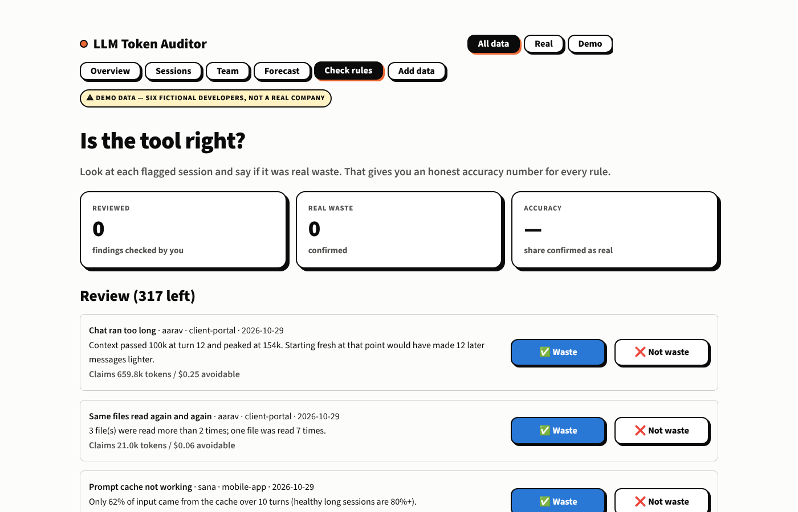

# 🔍 LLM Token Auditor

**Find the tokens your AI coding agent wasted, see why, and fix it.**



[](https://github.com/GuneshYeole07/AI-Usage-Cost-Tracker/actions)
[](https://www.python.org/downloads/)

Provider dashboards tell you **how much** you spent on AI. This tool tells you **how much of it was avoidable, why, and what to change.**

It reads usage metadata from AI coding agents (Claude Code session logs today), runs six explainable waste rules over every session, and shows the result as a dashboard, a weekly report, and a live in-editor warning.

> **Privacy first.** It runs on your machine and stores only token counts, model names, tool names, error flags and hashed file paths. Prompt and response text is discarded while reading and never stored.

---

## Screenshots

| Sessions | Team |
|---|---|
|  |  |
| **Forecast** | **Check rules** |
|  |  |

## Why this exists

Small tasks can burn huge token counts without anyone noticing:

- Every message in a long chat **resends the whole history**. Message 60 costs far more than message 1.
- Agents **retry failing commands** in a loop.
- The same file gets **read again and again**.
- Fifteen connected tools make **every single message heavier**.
- The top model gets used to **rename a variable**.

The result: teams hit usage limits early and pay for bigger plans. The bill shows the total, never the cause.

## What it does

| Feature | What you get |
|---|---|
| **Waste rules** | Six deterministic rules. Each finding shows its evidence, the avoidable tokens and dollars, and a concrete fix. |
| **Session explorer** | Context growth message by message, with failed tool calls marked. |
| **Team view** | Usage and avoidable share per developer, with each person's biggest issue. |
| **Forecast** | Will the team hit its monthly token budget, and would the fixes prevent it? |
| **Rule validation** | Mark findings as "real waste" or "false alarm" to measure each rule's precision. |
| **Token Guard hook** | A live warning inside Claude Code when a chat gets too long or the agent is looping. |
| **Weekly report** | A Markdown summary you can schedule and send. |

### The six rules

| Rule | Flags when | Fix it suggests |
|---|---|---|
| Chat ran too long | Context passes 100k tokens | Start fresh or `/compact` with a short summary |
| Agent stuck in a loop | 4+ failing tool calls in a row | Stop after 2 failures and give a specific hint |
| Same files read again | A file is read more than twice | Point the agent at exact files and lines |
| Heavy startup context | First message already over 65k tokens (a normal Claude Code start is ~50k) | Disable unused MCP servers, trim CLAUDE.md |
| Big model for a small task | Top-tier model on a short, low-output session | Use a smaller model for quick edits |
| Prompt cache not working | Under 70% cache hits on a long session | Avoid long pauses mid-session |

All thresholds are in `app/config.py` and visible at `GET /rules`. Nothing is a black box.

**Calibrated on real data.** The first version assumed a session starts at ~12k tokens. Real Claude Code sessions start at 49k–83k (built-in instructions and tools), so every real session was wrongly flagged. The thresholds and the long-chat baseline were recalibrated on real sessions.

**How "avoidable" is calculated.** Estimates are conservative on purpose. For long chats the tool asks: *what if you had started fresh when the context crossed the threshold?* A fresh chat regrows too, so only the history a reset would have dropped is counted, not the whole context. Rules never count the same tokens twice.

---

## Quick start

```bash
git clone https://github.com/GuneshYeole07/AI-Usage-Cost-Tracker.git
cd AI-Usage-Cost-Tracker

python -m venv .venv
.venv\Scripts\Activate.ps1          # Windows PowerShell
# source .venv/bin/activate         # Linux / macOS

pip install -r requirements.txt
```

Terminal 1, backend:

```bash
uvicorn app.main:app --port 8000
```

Terminal 2, dashboard:

```bash
streamlit run dashboard/app.py
```

Open <http://localhost:8501>, go to **Import data**, and either load the simulated demo team or upload your own logs. API docs are at <http://localhost:8000/docs>.

### Use your real Claude Code data

```bash
python scripts/import_claude_code.py --user yourname
```

This reads `~/.claude/projects` (Windows: `C:\Users\<you>\.claude\projects`). Re-running it is safe; sessions are updated, never duplicated.

### Load the demo data from the terminal

```bash
python scripts/seed.py
```

### Docker

```bash
docker compose up --build
```

---

## Automation

**Token Guard (live warning in Claude Code).** Add this to `~/.claude/settings.json` with the full path to the file:

```json
{
  "hooks": {
    "UserPromptSubmit": [
      {"hooks": [{"type": "command", "command": "python C:/full/path/to/hooks/token_guard.py"}]}
    ]
  }
}
```

It warns when a chat passes 100k tokens (and again every 40k after that), and when the last 4 tool calls all failed. It uses only the Python standard library and sends nothing anywhere. Tune it with the `TOKEN_GUARD_WARN`, `TOKEN_GUARD_STEP` and `TOKEN_GUARD_LOOP` environment variables.

**Daily auto-import (Windows Task Scheduler):**

```powershell
schtasks /Create /SC DAILY /ST 19:00 /TN "TokenAuditorImport" /TR "C:\path\to\.venv\Scripts\python.exe C:\path\to\scripts\import_claude_code.py --user yourname"
```

**Weekly report:**

```bash
python scripts/weekly_report.py --days 7 --out report.md
```

**CI:** GitHub Actions runs `ruff` and `pytest` on Python 3.10, 3.11 and 3.12 for every push.

---

## API

| Method | Endpoint | Purpose |
|---|---|---|
| `GET` | `/health` | Service and database check |
| `GET` | `/rules` | The rules and their thresholds |
| `POST` | `/import/claude-code` | Upload `.jsonl` session logs |
| `POST` | `/sessions` | Generic ingestion for other agents or API traffic |
| `GET` | `/overview` | Totals, avoidable share, breakdown by cause |
| `GET` | `/findings` | Every finding, filterable by `rule` and `user` |
| `GET` | `/sessions`, `/sessions/{id}` | Session list and turn-by-turn detail |
| `GET` | `/users`, `/daily`, `/forecast` | Team, trend and budget views |
| `GET` `POST` | `/validation`, `/labels` | Review findings and measure rule precision |
| `POST` `DELETE` | `/demo/seed`, `/demo` | Load or remove the simulated data |

Most `GET` endpoints accept `source=all|real|simulated`.

## Project layout

```
app/          FastAPI backend: parser, rules, analytics, pricing, simulator
dashboard/    Streamlit dashboard
hooks/        Token Guard hook for Claude Code
scripts/      import_claude_code.py, seed.py, weekly_report.py
alembic/      database migrations
tests/        31 tests: parser, rules, pricing, API, hook
```

## Testing

```bash
pytest -v
ruff check .
```

---

## Honest limitations

- **The demo data is simulated.** Six fictional developers, each given one bad habit on purpose. On that data the tool flags about a quarter of tokens as avoidable. That number describes the simulator, not any real company.
- **Rules are heuristics.** A long chat is sometimes necessary. Use the **Validate rules** page to measure precision on your own sessions before quoting any savings figure.
- **Costs are estimates** from the price table in `app/pricing.py`. Update it to current rates.
- **Coverage.** Claude Code logs and anything sent to `POST /sessions`. The ChatGPT and Claude web apps do not expose per-message usage, so they cannot be audited.
- **Token Guard** follows Claude Code's documented hook interface and is tested against sample transcripts. Check it once on your own install.

## Roadmap

- Before/after measurement: apply the fixes for two weeks and compare
- Importers for Cursor and other agents
- A small classifier that predicts task size from the first few turns and suggests a model
- Slack/email delivery for the weekly report and budget alerts
